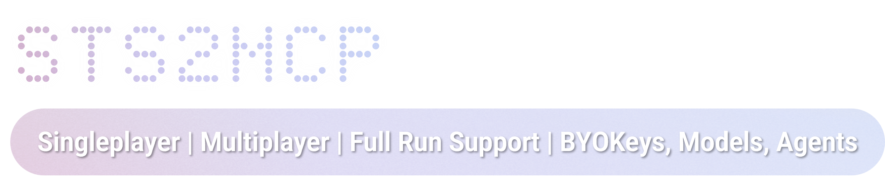

<p align="center">
  
</p>

<p align="center"><em>A fork of STS2MCP used as the observability / ground-truth oracle for a Slay the Spire 2 emulator</em></p>

A mod for [**Slay the Spire 2**](https://store.steampowered.com/app/2868840/Slay_the_Spire_2/) that exposes game state and actions over a localhost REST API, with an optional MCP server for Claude Desktop / Claude Code.

> [!important]
> **This is a fork of [Gennadiyev/STS2MCP](https://github.com/Gennadiyev/STS2MCP). This end goal this fork is so
> that [evangambit/sts2](https://github.com/evangambit/sts2) can learn to emulate and play Slay the Spire 2. We
> have made several modifications to enable testing the emulator against the real game.
> 
> That changes what the mod is asked to do — it must reach a *chosen*
> encounter, event or shop on demand, start a *seeded* run, stage an exact combat position, and report
> state in the game's true internal order rather than in display order. Those capabilities are the bulk
> of what this fork adds; see [What this fork adds](#what-this-fork-adds).

Upstream's feature set is all still here and unmodified: singleplayer and multiplayer (co-op), full menu
and lobby control, profile switching, character select, the compendium/profile/wiki endpoints. Tested
against STS2 `v0.107.1` — the fork's additions were reconstructed from that version's decompiled APIs, and
several of them exist because `v0.107` removed or moved what upstream relied on.

> [!warning]
> This mod allows external programs to read and control your game via a localhost API. Use at your own risk with runs you care less about.

> [!caution]
> Multiplayer support is in **beta** — expect bugs. Any multiplayer issues encountered with this mod installed are very likely caused by the mod, not the game. Please disable the mod and verify the issue persists before reporting bugs to the STS2 developers.

## What this fork adds

All additions are on the HTTP API (`POST /api/v1/singleplayer` with an `action` field, or the state
returned by `GET /api/v1/singleplayer`). **They are not exposed through the bundled MCP server**, and
`docs/raw-*.md` is upstream's API reference and does not describe them — this section and
[FORK_NOTES.md](FORK_NOTES.md) are their documentation.

### Reaching a chosen room on demand — `McpMod.Debug.cs`

Ground truth for a specific encounter, event or shop is unobtainable if you have to play until the game
happens to offer one. These jump straight there against the current run state:

```json
{"action": "debug_start_encounter", "encounter": "CorpseSlugsWeak"}
{"action": "debug_start_event",     "event":     "SelfHelpBook"}
{"action": "debug_start_shop"}
```

- `debug_start_encounter` builds a `CombatRoom` for the named encounter and enters it.
- `debug_start_event` enters the named event's room. `EventModel` seeds its own Rng from the run seed, the
  current floor, and a hash of the event id — so **capture the floor alongside the readout**, or the
  result is not reproducible.
- `debug_start_shop` enters a merchant room; `MerchantRoom` rolls its own stock in `EnterInternal`, so
  there is nothing to pass in.

Room entry is async and fire-and-forget: the caller polls the state until the room appears. See
[state-reading hazards](#state-reading-hazards) below — polling naively will read torn state.

### Staging an exact combat position — `McpMod.Debug.cs`

Per-card ground truth otherwise depends on what a run happens to deal you. These isolate one card:

```json
{"action": "debug_add_card",  "card": "MOLTEN_FIST", "upgraded": true, "pile": "hand"}
{"action": "debug_set_energy", "amount": 9}
{"action": "debug_add_power",  "power": "VULNERABLE_POWER", "amount": 2, "target": "CORPSE_SLUG_0"}
{"action": "debug_force_play_phase"}
```

- `debug_add_card` — pile is one of `hand`, `draw`, `discard`, `exhaust`, `deck` (default `hand`). The card
  instance comes from `ModelDb` and is cloned via `CombatState.CreateCard`; a hand-constructed model has no
  `Id.Entry` and an `ToMutable()` clone has no owner, and both fail *silently*.
- `debug_set_energy` — guarantees the card under capture is affordable, so a failed play cannot masquerade
  as a passing no-op diff.
- `debug_add_power` — stages a power on an enemy, or on the player with `"target": "player"`, so the
  conditional half of an effect can be observed.
- `debug_force_play_phase` — reports play-phase readiness after a `debug_start_encounter` (the combat may
  still be in its start sequence).

### Seeded runs — `McpMod.CustomRun.cs`

Seed-for-seed comparison against the emulator needs a run started from a chosen seed. `NCustomRunScreen`
now reports as `menu_screen: "character_select"` with `custom_run: true`, and `menu_select` drives it:

```json
{"action": "menu_select", "option": "Ironclad"}
{"action": "menu_select", "option": "ascension", "seed": "20"}
{"action": "menu_select", "option": "confirm",   "seed": "MYSEED123"}
```

Custom mode accepts `Lobby.SetSeed`; the standard character-select screen rejects seeds. `ascension`
reuses the `seed` field to carry the level, because `menu_select` has no other free parameter.

### State the game did not report

- **`deck`** — the run deck, on every screen. It is not a combat pile, so upstream reported it nowhere;
  outside combat every pile is empty, and the deck is exactly what events that transform, upgrade, add or
  remove cards act on. Without it, a harness cannot see the deck an agent is supposed to be building.
- **`draw_pile_ordered`, `discard_pile_ordered`, `hand_ordered`** — true pile order (index 0 = top, drawn
  next) with raw entry ids. Upstream's `draw_pile` is sorted by rarity/id to match the in-game display, so
  it cannot be used to compare card *sequences*. Both views are kept; existing consumers rely on the
  sorted one.
- **`rooms_entered`** — a count of room entries that have run to completion. `RunManager.EnterRoomInternal`
  is async and fires `RoomEntered` as its last statement, while the HTTP state reports a non-menu state
  well before that. A harness embarking runs back to back waits for this to advance before acting.

### Menu and lifecycle

- **`return_to_main_menu`** — save-and-quit to the main menu via `NGame.Instance.ReturnToMainMenu()` (the
  pause menu's Save-and-Quit path). `v0.107` removed the old action; the harness's abandon flow needs it.

### State-reading hazards

Found the hard way; a harness that ignores them silently records wrong ground truth.

- `GET /api/v1/singleplayer` can return **HTTP 500 while a room transition is in flight** — reliably when
  entering Fake Merchant, whose screen is built as a shop. It clears once the room settles. A poller
  should treat a failed read across a `debug_start_*` as "not there yet", not as an error: a batch that
  gives up on the read never posts its next jump and strands itself in the room it could not read.
- The state reports **the event id before that event's option list**. Waiting for the first state naming
  the right event yields the *previous* event's options under the new event's name. Wait for the option
  list to both change and hold still.
- **Rapid `abandon → re-embark → debug_start_encounter` cycling crashes the game** (error popup). Use
  single clean sequences with generous waits. Hardening these actions with settled-state guards is a
  tracked follow-on.

## For Players

### 1. Install the Mod

Build from source (see [For Developers](#for-developers)), or grab an
[upstream release](https://github.com/Gennadiyev/STS2MCP/releases/latest) if you only want upstream's
feature set — **released DLLs do not contain this fork's additions**.

The mod loads from a per-mod subdirectory named after the mod id, with the manifest kept as
`mod_manifest.json`:

```
<game_install>/mods/STS2_MCP/STS2_MCP.dll
<game_install>/mods/STS2_MCP/mod_manifest.json
```

Launch the game and enable mods in settings (a consent dialog appears on first launch). The mod starts an
HTTP server on `localhost:15526` automatically. **The mod loads at boot — restart the game after
installing or rebuilding.**

> [!note]
> The DLL is a platform-agnostic .NET assembly — the same build works on Windows, Linux, and macOS. No separate builds are needed.

#### macOS install

On macOS the mods directory lives inside the app bundle. The default Steam install path is:

```
~/Library/Application Support/Steam/steamapps/common/Slay the Spire 2/
    SlayTheSpire2.app/Contents/MacOS/mods/STS2_MCP/
```

Finder hides bundle contents by default — right-click `SlayTheSpire2.app` → **Show Package Contents**, or
copy from the terminal:

```bash
GAME_DIR="$HOME/Library/Application Support/Steam/steamapps/common/Slay the Spire 2"
MODS_DIR="$GAME_DIR/SlayTheSpire2.app/Contents/MacOS/mods/STS2_MCP"
mkdir -p "$MODS_DIR"
cp out/STS2_MCP/STS2_MCP.dll "$MODS_DIR/"
cp mod_manifest.json         "$MODS_DIR/"
```

Launch the game and open **Settings → Mods** — the mod should appear in the list. Then verify the server:

```bash
curl -s http://localhost:15526/
```

A successful response looks like:

```json
{"message": "Hello from STS2 MCP v0.4.0+2de67cd", "status": "ok", "version": "0.4.0", "commit": "2de67cd", "schema_version": 3}
```

`commit` is the git revision the mod was built from (`null` if the build could not determine one) —
quote it when reporting a bug. `schema_version` changes only when an existing state field or action
changes meaning or is removed; new fields and actions do not bump it. Every state payload carries the
same three values as `mod_version`, `mod_commit` and `schema_version`.

If you get "Connection refused", the mod is not loaded — check that mods are enabled in the game's settings.

### 2. Give Your AI Instructions to Interact with the Game

**Clone or download the repository**, then:

| I prefer a skill | I prefer an MCP Server |
|---|---|
| Tell AI to reference docs/raw-*.md. Sit back, and watch it play. | Requires [Python 3.11+](https://www.python.org/) and [uv](https://docs.astral.sh/uv/). Follow the instructions below ⬇️ |

Both paths cover **upstream's** action set only. The fork's additions are HTTP-only and documented above.

#### MCP server setup

Install [uv](https://docs.astral.sh/uv/) if you don't have it (macOS: `brew install uv`). Then run the server once to install dependencies:

```bash
uv run --directory /path/to/STS2_MCP/mcp python server.py --help
```

`uv` reads `mcp/pyproject.toml`, creates an isolated virtual environment, and installs the pinned dependencies from `mcp/uv.lock`. Subsequent runs reuse the environment instantly.

Add the server to your AI client's MCP config:

```json
{
  "mcpServers": {
    "sts2": {
      "command": "uv",
      "args": ["run", "--directory", "/path/to/STS2_MCP/mcp", "python", "server.py"]
    }
  }
}
```

**Claude Code**: add to your project's `.mcp.json`.
**Claude Desktop**: add to `claude_desktop_config.json` with the same config as above.
*Other agents should have similar config options for custom MCP servers.*

> [!tip]
> On macOS, use the absolute path to `uv` (e.g. `/opt/homebrew/bin/uv`) in the `command` field. GUI-launched apps may not inherit your shell's `PATH`, which would prevent the server from starting.

Restart your Claude session after adding the config. To verify the MCP server is working, ask Claude to call `get_game_state` — with the game running, it should return the current game state.

The MCP server accepts `--host` and `--port` options if you need non-default settings.

Flag `--no-trust-env` can be used to disable `requests` from picking up proxy settings from the environment, which can cause connection issues if you are running the server in a container.

### Profile and Compendium Data

Unchanged from upstream. The HTTP API exposes profile-level progress separately from live run state:

- `GET /api/v1/profile` returns the active profile's persistent progress summary, including discoveries, achievements, epochs, character totals, and global run totals.
- `GET /api/v1/compendium` groups that progress into the same high-level sections as the in-game Compendium: Card Library, Relic Collection, Potion Lab, Bestiary, Character Stats, and Run History.
- `GET /api/v1/wiki?query=...` searches discovered card and relic wiki entries for the active profile with fuzzy matching. Results are limited to 10 by default and can be overridden with `limit`; card results include base and upgraded variants when available.
- `GET /api/v1/profiles` lists the three profile slots and the active profile.
- `POST /api/v1/profiles` switches or deletes profile slots through the game UI.

The MCP server exposes the same profile data through `get_profile()`, `get_compendium()`, `search_wiki(query, item_type, limit)`, `list_profiles()`, `switch_profile(profile_id)`, and `delete_profile(profile_id)`.

`get_compendium()` is intended for agents that need durable context outside the current room or current run. It works from the main menu, includes a `current_run` block while a run is active, and summarizes saved `saves/history/*.run` files for the active profile. Run history is capped to the 20 most recent files in the response so long-lived profiles do not create unbounded tool output.

`search_wiki()` is the selective lookup path for durable card and relic text. It never returns the full game catalog: the mod first filters to the active profile's discovered card and relic IDs, then returns only the best fuzzy matches. Use `item_type="card"` or `item_type="relic"` when the query is known, and raise `limit` only when the default 10 results are not enough.

## For Developers

### Build & Install

Requires the [.NET 9 SDK](https://dotnet.microsoft.com/download/dotnet/9.0) and the base game.

**PowerShell** (Windows):

```powershell
# Pass game path directly:
.\build.ps1 -GameDir "D:\SteamLibrary\steamapps\common\Slay the Spire 2"

# Or set it once and forget:
$env:STS2_GAME_DIR = "D:\SteamLibrary\steamapps\common\Slay the Spire 2"
.\build.ps1
```

The script builds `STS2_MCP.dll` into `out/STS2_MCP/`. Copy it and the manifest into the mod's own
directory to install:

```
out/STS2_MCP/STS2_MCP.dll  ->  <game_install>/mods/STS2_MCP/STS2_MCP.dll
mod_manifest.json          ->  <game_install>/mods/STS2_MCP/mod_manifest.json
```

### Build instructions for macOS

`build.ps1` is Windows-only; build with `dotnet` directly. Install the .NET 9 SDK from Microsoft's
[installer script](https://dotnet.microsoft.com/download/dotnet/9.0) (it lands in `~/.dotnet`) or via
`brew install dotnet@9` — Homebrew installs it keg-only, so it needs `DOTNET_ROOT` and `PATH` exports.

```bash
GAME_DIR="$HOME/Library/Application Support/Steam/steamapps/common/Slay the Spire 2"
~/.dotnet/dotnet build STS2_MCP.csproj -c Release -o out/STS2_MCP -p:STS2GameDir="$GAME_DIR"
```

On macOS the game ships as an app bundle. The `.csproj` detects macOS and resolves the data directory to
`SlayTheSpire2.app/Contents/Resources/data_sts2_macos_arm64` automatically. Install with the copy commands
in [macOS install](#macos-install) above, then **restart the game** — the mod loads at boot.

### Staying current with upstream

The `upstream` remote points at [Gennadiyev/STS2MCP](https://github.com/Gennadiyev/STS2MCP); pull upstream
fixes from there. The fork's changes are additive and confined to `McpMod.Debug.cs`,
`McpMod.CustomRun.cs`, and insertion points in `McpMod.Actions.cs`, `McpMod.StateBuilder.cs` and
`McpMod.cs`, so upstream merges have stayed cheap. Some of the fork-only code in the shared files carries
a `FORK ADDITION` comment; for the authoritative view, diff against the last upstream commit
(`git diff 55e0648 HEAD`).

## License

MIT

## Upstream

The rationale for the original project — why let an AI play, whether it counts as cheating, token costs
per run, the upstream roadmap — is answered in
[upstream's README](https://github.com/Gennadiyev/STS2MCP#faq). This fork's own reason for existing is
narrower: it is the oracle half of an emulator project, and the features above were written to make the
real game answer questions a test harness needs to ask.
